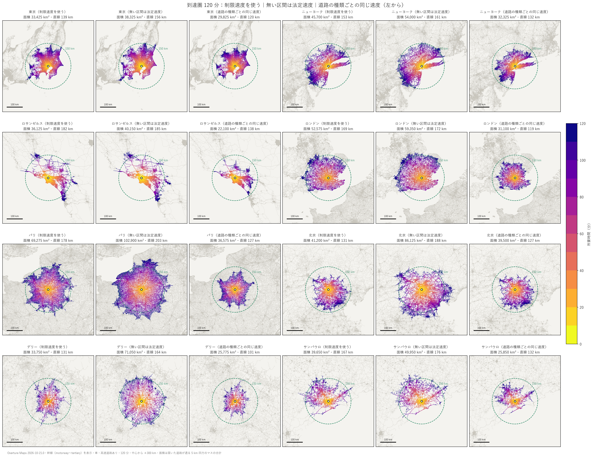

# overture-road-route-search

[Overture Maps](https://overturemaps.org/) の道路データ（transportation）から全球の道路ネットワークを作り、
車の**到達圏**と**経路探索**をローカルで動かして検証するリポジトリ。

- 道路は幹線だけ（motorway・trunk・primary・secondary・tertiary とそのランプ）。一方通行と制限速度を使う
- 探索は scipy の Dijkstra（メモリ上の有向グラフ）。API は FastAPI、画面は SvelteKit ＋ MapLibre ＋ PMTiles
- 仕組みは姉妹プロジェクト `../ksj-route-search-api`（国土数値情報 N13 版・日本全国）から移植した
- 公開はしていない。手元の PC（64 GB）での検証まで

全球のネットワークは 7,424 万リンク・6,788 万ノード・1,771 万 km。到達圏 120 分は 0.2〜0.5 秒、
大陸をまたぐ経路（リスボン→シンガポール 16,511 km）は 4.5 秒で返る。



都市を比べるときは前提に注意（制限速度の入り方・道路の分類が国で違う）。左から、制限速度を使った版・制限速度の無い区間を国の法定速度で埋めた版・全都市で道路の種類ごとに同じ速度にした版。詳しくは [docs/network_world.md](docs/network_world.md#都市どうしを比べるときの前提issue-4)。

## 文書

| ファイル | 内容 |
|---|---|
| [PLAN.md](PLAN.md) | 進め方・決めたこと・段階ごとの状況・全球の検証結果 |
| [docs/speed.md](docs/speed.md) | 速度と所要時間の仕様（制限速度・class の既定値・法定速度、3 通りの速度の使い分け） |
| [docs/network_world.md](docs/network_world.md) | 全球版の道路ネットワークの概要（作り方・規模・class ごと・つながっている範囲・気をつけること） |
| [docs/coverage.md](docs/coverage.md) | 日本での網羅率（道路統計年報・国土数値情報 N13 との比較） |

## 必要なもの

- [uv](https://docs.astral.sh/uv/)（Python の依存は `pyproject.toml`）
- Node.js（画面）
- [tippecanoe](https://github.com/felt/tippecanoe)（道路タイル。Windows では WSL に入れて `--wsl` で呼ぶ）
- メモリ: 全球の API は常駐 16 GiB、探索グラフの組み立ては最大 25 GiB。ディスク: 全球で 50 GB ほど

```sh
uv sync
cd web && npm install
```

## 作り方

`--case jp`（日本）と `--case world`（全球）がある。日本は先に `01_fetch.py` で取得しておく。

| スクリプト | やること | 全球での時間 |
|---|---|---|
| `scripts/01_fetch.py` | 日本の segment / connector を取得（`data/jp/`） | — |
| `scripts/02`〜`07` | 日本の網羅率の検証と QGIS での表示用（`docs/coverage.md`） | — |
| `scripts/08_fetch_world.py` | 全球の幹線の segment を S3 から取得（`data/world/`、128 ファイル・8.1 GB）。止まっても続きから取れる | 約 4 時間 |
| `scripts/09_build_network.py --case world` | connector で切り分けてリンク・ノードにする（`network/world/links.parquet`・`nodes.parquet`） | 19 分 |
| `scripts/10_build_graph_arrays.py --case world --no-verify` | 組み立て済みの探索グラフを書き出す（`network/world/graph/`、15.4 GiB） | 2 分 |
| `scripts/11_make_pmtiles.py --case world --wsl` | 画面の道路タイル（`network/world/roads_world.pmtiles`、3.7 GB）。`--bbox` で範囲を切り出せる | 6.7 時間 |
| `scripts/12_bench.py --case world` | 読み込み・到達圏・経路の速度とメモリを測る | 1 分 |
| `scripts/10_build_graph_arrays.py --case world --no-verify --speed class` | 制限速度を使わない（class の既定値だけの）探索グラフ（`network/world/graph_class/`）。都市を同じ条件で比べるため | 2 分 |
| `scripts/14_legal_speeds.py --case world` | 制限速度の無いリンクに国（州）の法定速度を当てる（`network/world/legal_speeds.parquet`）。続けて `10_build_graph_arrays.py --speed legal` | 5 分 |
| `scripts/13_reach_maps.py fetch` / `draw` | 主要都市の到達圏を同じ縮尺の画像にする（API を起動しておく。使い方はスクリプトの先頭） | 数分 |

```sh
uv run python scripts/08_fetch_world.py
uv run python scripts/09_build_network.py --case world
uv run python scripts/10_build_graph_arrays.py --case world --no-verify
uv run python scripts/11_make_pmtiles.py --case world --wsl
```

`data/`・`network/`・`*.pmtiles` は git に入れない。

## ローカルで動かす

1. API（ポート 8010）。`ROUTE_CASE` で読むネットワークを選ぶ（既定は jp）

   ```sh
   ROUTE_CASE=world uv run uvicorn api.main:app --port 8010
   ```

   PowerShell では `$env:ROUTE_CASE='world'; uv run uvicorn api.main:app --port 8010`。全球は読み込みに 20 秒ほどかかる。
   `ROUTE_SPEED` で速度を選ぶ: `posted`（既定。制限速度を使う）・`legal`（無い区間は法定速度）・`class`（道路の種類ごとの同じ速度）

2. 道路タイルを画面から見える場所に置く（ネットワークと同じ case のタイルにする。link_id がずれると到達圏の色が違う道に付く）

   ```powershell
   cmd /c mklink /H web\static\tiles\roads.pmtiles network\world\roads_world.pmtiles
   ```

3. 画面（Vite が `/api` を 8010 に中継する）

   ```sh
   cd web && npm run dev            # http://localhost:5173
   ```

API: `GET /health`、`GET /reachability?lat=&lon=&limit_min=&use_expressway=`、`GET /route?from_lat=&from_lon=&to_lat=&to_lon=&use_expressway=`。

## データの出典

- 道路: © [Overture Maps Foundation](https://overturemaps.org/)（transportation テーマ、リリース 2026-10-21.0）。元の多くは © OpenStreetMap contributors（ODbL）
- 法定速度: [osm-legal-default-speeds](https://github.com/westnordost/osm-legal-default-speeds)（元は OSM wiki「Default speed limits」、CC BY-SA 2.0）。`data/legal_speeds/` に置く
- 背景地図（画面）: [OpenFreeMap](https://openfreemap.org/)
